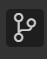
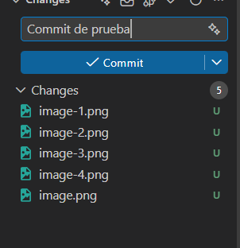
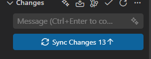
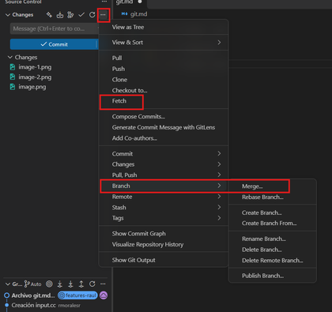
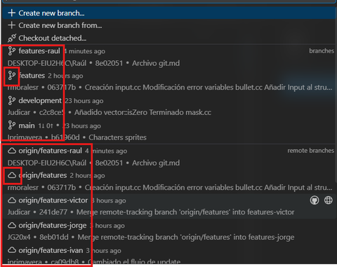
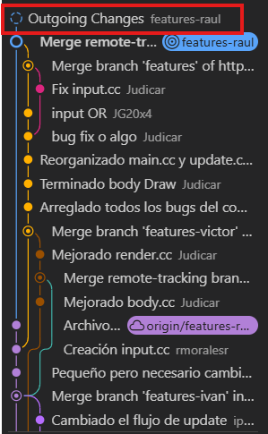
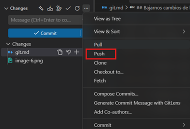

# Guía rápida de Git en VS Code

## Flujo de trabajo (resumen)

//TODO Añadir imagen Carmina conflictos

**Trabajar en nuestra rama**

1. Abrir el apartado de Git y comprobar que estamos en **nuestra rama**.
2. Hacer **una sola tarea**, compilar y comprobar que funciona.
3. **Commit** con un mensaje detallado.
4. **Sync Changes** para subirlo a nuestra rama.

**Tarea terminada y probada: publicarla en `features`**

5. **Cambiar a la rama `features`**.
6. **Pull** para tener `features` al día.
7. **Merge** de nuestra rama de la nube (icono de nube).
8. **Push** para subir `features` a la nube.
9. **Avisar al equipo** de que hay cambios nuevos.
10. **VOLVER A NUESTRA RAMA.**

**Cuando un compañero avisa de que ha subido a `features`**

11. **Fetch** para descargar lo que hay en la nube.
12. **Merge** de `origin/features` (icono de nube) en nuestra rama.
13. **Push** para subir el resultado a nuestra rama.
14. **Seguir programando en NUESTRA rama.**

---

## 1. Dónde está Git en VS Code

El apartado de Git es este icono de la barra lateral:

## 2. Comprobar la rama actual

En la barra inferior de VS Code se indica la rama en la que estamos:

> **CUIDADO:** comprobad **SIEMPRE** que estáis en **vuestra rama** antes de tocar nada.

## 3. Subir nuestros cambios a nuestra rama (Commit)

Los cambios siempre se suben primero a **nuestra rama personal**. Cuando terminemos una tarea, compilemos y comprobemos que funciona, la subiremos a la rama `features`.

> **Nota:** `features` es la rama donde convergen todos los cambios (los propios y los de los compañeros), así que hay que tener cuidado con lo que se sube para no romper nada.

**Paso 1: Commit.** En el bloque superior de la pestaña de Git escribimos el mensaje y pulsamos **Commit**. El mensaje debe ser **lo más detallado posible**: así el historial es legible para todos y es más fácil localizar el commit donde se coló un bug o un error.

**Paso 2: Sync Changes.** Una vez hecho el commit, pulsamos **Sync Changes** para subirlo a la nube.

## 4. Bajarnos cambios de los compañeros (Fetch → Merge → Push)

Cuando un compañero publique algo en `features`, **avisará al resto**. Entonces cada uno, **desde su propia rama**, debe seguir estos pasos para traerse esos cambios:

### 4.1. Fetch y Merge

Desde el menú `...` de la pestaña de Git:

1. **Fetch**: descarga la información de lo que hay en la nube.
2. **Branch → Merge...**: fusiona esos cambios con nuestra rama.

### 4.2. Elegir la rama correcta (la de la nube)

Al elegir rama para el merge, hay que **elegir siempre la opción con el icono de la nube**. Es importante diferenciarlas:

| Icono | Significado |
|---|---|
| Rama (el mismo icono que usa VS Code) | Rama **local**: contiene nuestros cambios en nuestro equipo. |
| Nube | Rama **remota** (GitHub): contiene el desarrollo subido por el compañero. |

### 4.3. Comprobar que se han bajado los cambios

En la vista del grafo de ramas (debajo de la zona de commit) aparecerá un nuevo cambio con el círculo de la rama **punteado** (*Outgoing Changes*). Significa que tenemos commits pendientes de subir: los que acabamos de mergear del compañero.

### 4.4. Push

Para dejar esos cambios en nuestra rama, hacemos **Push**, que sube a la nube el código que tenemos commiteado.

> **Recordad:** al terminar, comprobad en la barra inferior que seguís en **vuestra rama** antes de seguir programando.

## 5. Publicar nuestros cambios en `features` (el merge al revés)

Subir a nuestra rama no basta: para que los compañeros reciban nuestro trabajo, tiene que estar en `features`. Es **el mismo proceso que el merge anterior, pero al revés**: en vez de traernos `features` a nuestra rama, llevamos nuestra rama a `features`.

1. **Cambiar a `features`**: clic en la rama de la barra inferior y elegir `features` (la local, con icono de rama).
2. **Pull**: desde el menú `...`, para tener `features` al día antes de fusionar.
3. **Branch → Merge...** y elegir **nuestra rama de la nube** (por ejemplo, `origin/features-raul`).
4. **Push**: sube `features` a la nube.
5. **Avisar al equipo** de que hay cambios nuevos en `features`.
6. **Volver a nuestra rama** (clic en la barra inferior y elegir la nuestra).

> **CUIDADO:** nunca programéis estando en `features`. Después del Push, **volved siempre a vuestra rama** y comprobadlo en la barra inferior.
