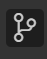
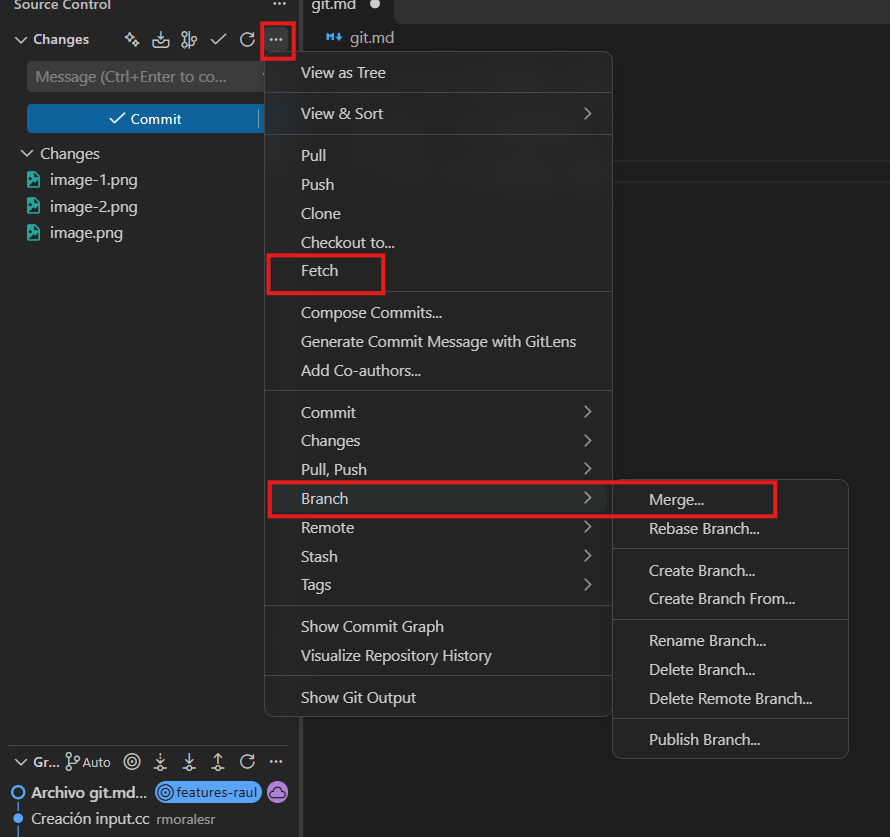
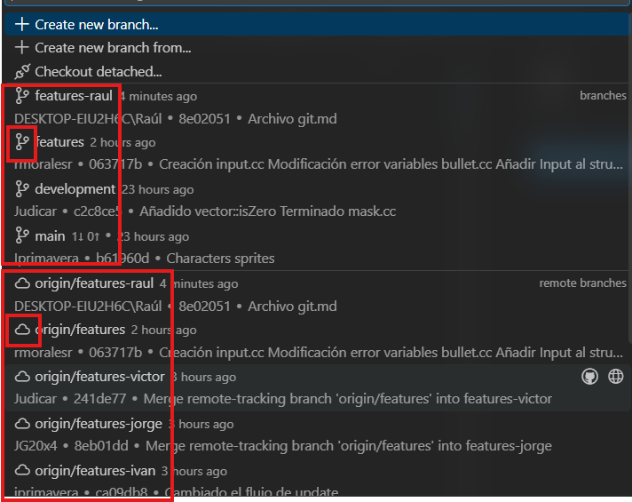
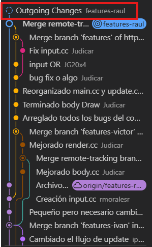
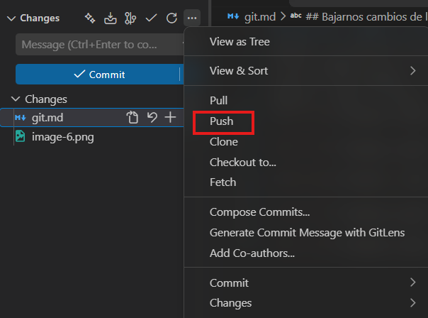
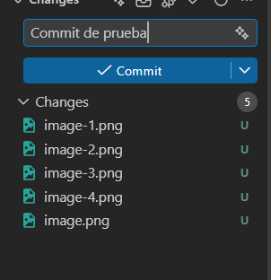
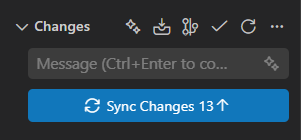

## El apartado de Git dentro del vscode es este icono en la barra lateral

## En la barra inferior del vscode nos indica la rama en la que estamos
> [!Caution]
> Comprobad **SIEMPRE** que estéis en vuestra rama
> 

## Bajarnos cambios de los compañeros (merge)
Los cambios siempre se suben a nuestras ramas personales. Vamos a intentar siempre hacer una única tarea a la vez, y cuando finalicemos esa tarea, compilemos y comprobemos que funcione, la subiremos a la rama features. La rama features es la rama donde convergen todos nuestros cambios, ya sean los propios o los de un compañero, por lo que tendremos que tener cuidado con lo que subimos para no romper nada. Cuando un compañero suba un cambio, deberá de notificar al resto de esta subida, y el resto tendrá que realizar los siguientes pasos para bajarse los cambios: fetch -> merge

Y siempre hay que elegir la opción de la nube. Es importante diferenciar las opciones al elegir rama. Las que tienen el mismo icono que usa vscode (el icono de ramas) indica que esa rama tiene tus cambios locales. En cambio, el icono de la nube indica que es el código que hay alojado en Git (GitHub), que es el que tendrá el desarrollo del compañero.

Para comprobar que se nos han bajado los cambios de nuestro compañero, en la vista de las ramas abajo de la zona de commit, veremos un nuevo cambio con el circulo de la rama punteado. Esto indica que tenemos cambios commiteados por subir (los cambios que nos hemos mergeado del compañero)

Para subir estos cambios y ya tenerlos en nuestra rama, faltaría hacer un push, que lo que hace es subir el código que tenemos commiteado a la nube

## Subir nuestros cambios a nuestra rama (Commit)
En el bloque superior de la pestaña aparecerá esta ventana. Aquí ponemos el mensaje con los cambios realizados. Si puede ser lo más detallado posible para ver el historial y trazas de los cambios realizados. De esta forma será más sencillo y legible tanto para nosotros como para nuestros compañeros, y será más fácil volver a ver commits por si se ha subido un bug o un error

Una vez puesto el mensaje y habiendole dado al commit, habrá que darle al Sync Changes para que se suba a la nube

